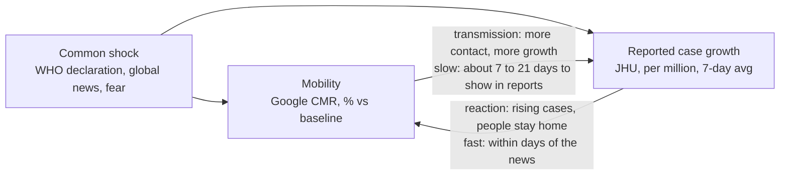

# Analysis plan

24 Oct 2026

This is a replication in three layers. We first reproduce the paper's results with its own data and methods, then re-answer its two questions with better methods, and only then add a few extensions. Data (Google CMR + JHU cases) and theme stay the same.

**Pitch:** we reproduced their results, found where the method breaks, and re-answered the same two questions properly.

| Layer | What it is | What we do |
| --- | --- | --- |
| **Replicate** | Same data, same method: do we get their numbers? | Kendall τ cross-correlations (Tables 1–2, Figs 1–2), mclust clusters, the three Tweedie GAMMs and their validation |
| **Reanalyse** | Same two questions, better method | Q1 (is mobility linked to cases, and how does it vary across countries?): placebo, growth-rate lag profiles, timing chart. Q2 (does mobility improve case modelling?): growth panel model in fixest, per-capita validation |
| **Extend** | New questions, clearly labelled; cut first if time is short | Clustering on mobility curves, phase plots, a renewal model for a few countries |

What the reanalysis changes, in one line each:

- **Outcome:** raw daily counts → weekly growth of cases per million (7-day average).
- **Correlation:** one "best lag" per country → the full lag profile, tested against a placebo benchmark.
- **Framing:** "mobility explains cases" → mobility and cases move together through feedback and common shocks; no causal claim.
- **Model:** Tweedie GAMM on counts with a date smooth → panel regression of case growth on lagged mobility (fixest), with country fixed effects and a period interaction.
- **Validation:** count-scale RMSE → error on growth / per-capita scale, so the US, Brazil and India don't dominate.
- **Visuals:** static maps + box plots → a story-led set of charts (heatmap, lag curves, timing chart, coefficient plots).

## What the original paper does

Sulyok & Walker (2020) correlate country-level mobility with daily new COVID-19 cases, then test whether mobility improves a case model. Their main claim is that mobility often fell *before* cases rose, which they read as people reacting to perceived risk ahead of legal restrictions.

| Step | What they did | Output |
| --- | --- | --- |
| Data | Google CMR for 135 countries, 15 Feb–19 Jun 2020, six categories as % change from a Jan–Feb baseline. JHU cumulative cases, differenced to daily new cases (negatives set to 0). Continents from GeoNames. | One merged country-day panel |
| Cross-correlation | Kendall's τ between mobility on day t and cases shifted by every lag from −28 to +28 days, per country and category. They keep only the largest \|τ\| and its lag. | Figs 1–2 (maps + box plots), Tables 1–2 (continent medians), Kruskal–Wallis + Dunn tests |
| Clustering | mclust on the τ values and lags | 4 country groups |
| Models | Tweedie GAMMs (mgcv) with a country random intercept: (1) date smooth only; (2) + five mobility categories on the same day (parks dropped); (3) + distributed lags of 0–14 days (dlnm) | Model 2 best by BIC (79,096) |
| Validation | Forecast 20 Jun–8 Sep 2020, RMSE on raw counts, Diebold–Mariano test | RMSE: lag model 6,690 < same-day 6,795 < date only 6,840 |

The headline pattern is strong negative τ for retail, grocery, transit and workplaces in Western Europe, North America, Russia and Australia, and the reverse for residential. South America is the exception.

## Problems in the original

The biggest issue is that their correlations mostly measure shared timing. Both series trend over the same months, and the method has no way to separate that from a real relationship.

| # | Problem | Why it matters | Evidence |
| --- | --- | --- | --- |
| 1 | **Correlation on trending levels.** Mobility collapsed in March and slowly recovered; cases climbed. | Any two series that trend over the same months show a high τ. The result may say "both changed in spring 2020", not "they are linked". | Not tested in the paper. Our placebo (step 5) checks it. |
| 2 | **Unstable "best lag".** They keep only the lag with the largest \|τ\| out of 57. | For smooth trends τ barely changes across lags, so the maximum lands almost anywhere. Picking the maximum is also a selection that inflates τ. | Supplement S1: 30% of chosen lags are at ±27 or ±28 (7% expected by chance); 23% are exactly ±28. |
| 3 | **Sign and direction mixed.** The largest \|τ\| is kept whatever its sign, and positive and negative lags are pooled. | Negative lags (mobility first) and positive lags (cases first) describe different things, yet they're summarised as one number. | Tables 1–2 |
| 4 | **Raw counts.** No population scaling, no smoothing of weekday reporting, early testing ramp-up ignored. | 50 cases a day and 50,000 cases a day are treated as the same kind of series; weekday cycles add noise to τ. | Methods section |
| 5 | **Date smooth in the models.** s(date) absorbs the time pattern and is then extrapolated into the forecast window. | Forecasts lean on an extrapolated curve, so mobility has little left to add. | Only a 2% RMSE gap between models (6,690 vs 6,840) |
| 6 | **Count-scale RMSE.** | Error is dominated by the largest countries; small countries barely count. Per country, the "best" model is actually the worst. | Supplement S3: median per-country RMSE is 280 (date only), 290 (same-day) and 413 (lag model). The largest country error is about 58,000. |
| 7 | **Same-day mobility as a predictor.** | Infection to reported case takes about 1–2 weeks, so same-day mobility can't drive same-day cases. And today's mobility partly reacts to recent cases, which biases the coefficient. | Model 2, the BIC winner |
| 8 | **BIC across different samples.** | In their code the lag model is fitted on different rows from the other two, so its BIC isn't comparable. | `fit1`/`fit2` on `datam`, `fitcb` on `datat` |
| 9 | **Overstated significance.** | Diebold–Mariano on thousands of autocorrelated, pooled errors makes almost any gap "significant". | p < 0.001 for a 2% difference |
| 10 | **Small groups.** | Oceania has 4 countries and South America 10, so continent box plots and tests are fragile. | Table 2 |
| 11 | **Code bug.** The residential lag is overwritten: `residential <- workplaces - 29`. | In that version of the code, residential lags are wrong. | Published Rmd. The supplement's residential lags don't follow the bug's pattern, so the published tables were likely made with corrected code. Mention it as a code-quality note only. |

To be fair to them: they say in the limitations that their method gives no insight into causes, and their distributed-lag model does respect the time order for mobility → cases.

## What the supplementary material shows

The supplement (S1 country table, S2 cluster summary, S3 code output; Word file in the authors' GitHub repo) strengthens three of the critiques with the authors' own numbers. It covers 122 countries, not the 135 downloaded.

| Finding | Their own numbers | What it means for us |
| --- | --- | --- |
| **Best lags pile up at the window edge** | 30% of the 732 country-category lags are at ±27/±28, vs 7% if lags were spread evenly; 23% are exactly ±28. 17 countries (14%) hit the edge in all six categories, including India, Poland, Peru, Nigeria and Ukraine. | The "best lag" is often just the maximiser hitting the ±28 limit. Our Fig 4 can be built straight from S1. |
| **Two of the four clusters are edge artefacts** | Cluster 3 (18 countries): median lag −28 in every category. Cluster 4 (11 countries): median lag +28 in every category, with τ flipped in sign. That's 29 of 122 countries (24%). | A quarter of the clustering is grouping countries by where the search window ends, not by real behaviour. Supports clustering on mobility curves instead (step 10). |
| **The "winning" model loses for the typical country** | Pooled RMSE: lag model 6,690 < same-day 6,795 < date only 6,840. Median per-country RMSE: date only 280 < same-day 290 < lag model 413. Largest single-country RMSE about 58,000. | The pooled ranking is driven by a few very large countries. For a typical country, adding mobility made forecasts worse. Strong reason to score on growth or per-capita scale. |
| **The significance tests are fragile** | Diebold–Mariano: DM = 13.4, p < 2.2e-16, with forecast horizon 1, on pooled errors from 123 countries. | Errors are autocorrelated and pooled across countries, so the p-value is not credible for a gap of about 2%. |
| **Sign flips are common** | Retail τ is positive in 22 of 122 countries; residential τ is negative in 23. | The "largest \|τ\|" summary mixes opposite relationships, consistent with the feedback-loop framing. |

One critique gets weaker: the residential-lag bug in the shared code doesn't appear in the supplement's numbers, so we treat it as a code note, not a flaw in the results.

## Our framing: co-movement, not a one-way story

We don't claim mobility drives cases or the reverse. Both moved together, and the paper's method can't tell why. Three things can produce the co-movement:

1. **A feedback loop.** More mobility raises transmission; rising cases make people (and governments) cut mobility. The two arrows have opposite signs.
2. **A common shock.** The WHO pandemic declaration (11 March 2020), global news and fear hit every country in the same weeks and moved both series.
3. **Shared timing.** Both series simply trend over the same months.



*One correlation mixes both arrows plus the shared shock, so it cannot show direction.*

Why this matters: one correlation mixes all three, so it can come out negative, positive or near zero depending on which dominates. A self-correcting loop can even flatten the raw correlation when both effects are strong, which may explain some of South America's "odd" positive values.

What we *can* say without a causal claim: how strong the co-movement is once trends are removed, which series turned first (a description of order, not cause), and whether mobility carries useful *information* for forecasting case growth.

## Spurious correlation: where it comes from and how we deal with it

The paper's correlations are at high risk of being spurious: large values that would appear even if mobility and cases were unrelated. Our plan removes most of the sources and measures what's left.

**What "spurious" means here.** Take any two series that both drift in one direction over the same months, such as the number of Netflix subscribers and the height of a growing child. Correlate them and you get a value near 1, with no connection between them. Statisticians have known this since Yule (1926), and Granger & Newbold (1974) showed regressions between such series produce "significant" results most of the time. Mobility and COVID-19 cases in spring 2020 are exactly this kind of pair.

### Four sources in the original analysis

| # | Source | Plain explanation | How it inflates their result |
| --- | --- | --- | --- |
| 1 | **Shared trends** | Mobility fell in March then slowly recovered; cases rose and fell over the same weeks. Both move with the calendar. | Kendall's τ picks up "both changed in spring" as if it were a link. |
| 2 | **Autocorrelation** | Each day's value is very close to yesterday's, so 120 days carry far less information than 120 independent observations. | A τ of 0.5 can arise by chance, and p-values that treat days as independent are far too small. |
| 3 | **Picking the best of 57 lags** | If you try 57 lags and keep the biggest, you'll always find something large, like rolling a die 57 times and reporting the highest roll. | The reported τ is biased upward; the ±28 pile-up in their supplement is the symptom. |
| 4 | **Common shock** | The WHO declaration and global news moved behaviour and testing in every country in the same weeks. | Both series move together because of a third factor, not because of each other (confounding). |

To be fair: their GAMMs include a smooth of date, which removes part of the shared trend. It's one global curve for all countries, so each country's own trend stays in.

### What we do about each source, and why it works

| Fix | Fixes | Why it works |
| --- | --- | --- |
| **Case growth instead of levels** | 1 | Growth is the change in log cases from one week to the next. Differencing removes the long upward drift, the way you'd compare monthly returns rather than stock prices. |
| **7-day averages** | 2 | Reporting dips every weekend in most countries. Averaging over a week removes that cycle, which would otherwise create fake 7-day patterns in the correlation. |
| **Stationarity checks (ADF + KPSS)** | 1 | Checks whether growth and mobility still trend after transformation. ADF assumes a trend and tests it away; KPSS assumes none and tests for one. Using both guards against either test's blind spot. We report the share of countries that pass. Repo script: `03_time_series/02_stationarity.R`. |
| **Prewhitening before cross-correlation** | 1, 2 | The textbook fix for correlating two time series (Box & Jenkins). Fit an ARIMA to mobility, which captures how each day depends on previous days, then filter both series with it. What's left is the "surprise" in each series, so any correlation reflects genuine co-movement, not each series' own memory. |
| **Full lag profiles, no maximum** | 3 | We show τ at every lag with uncertainty bands instead of keeping only the largest. No selection, no inflation. |
| **Placebo benchmark** | 1, 2, 3, 4 | Pair Germany's mobility with Brazil's cases. They share the calendar and the global shock but have no direct link. Whatever τ these mismatched pairs produce is the spurious baseline; only correlation above it counts as evidence. This is our most direct measure of how much is spurious. |
| **Date fixed effects** | 4 | In the panel model, a separate intercept for each day absorbs everything that hit all countries that day (WHO declaration, global news). What remains is how countries differ from each other on the same day. |
| **Lagged growth as a control** | 2 | Growth today predicts growth next week. Controlling for it stops mobility from getting credit for the epidemic's own momentum. |
| **Country-specific trends (robustness)** | 1 | Adds a separate linear time trend per country. Handles each country's epidemic phase, e.g. growth falling in May as the first wave peaked. |
| **Driscoll–Kraay standard errors** | 2, 4 | Clustering by country handles correlation over time within a country. Driscoll–Kraay also allows countries to be correlated on the same day, which they are because of common shocks. In fixest: `vcov = "DK"`. |

### A trap to warn the audience about

Growth isn't automatically trend-free. In most countries growth fell steadily through April–May as the first wave peaked, while mobility slowly recovered. A naive correlation of the two would show "more mobility, *less* growth", which is spurious in the opposite direction to transmission. Date fixed effects remove the shared part; country trends and the lagged-growth control handle each country's own phase. If we skip these, we risk replacing their spurious result with one of our own.

### How we show it

One slide: the same pair of series correlated three ways (raw levels, growth, prewhitened growth), each against its placebo band. The audience sees the apparent correlation shrink at each step. The gap between the real and placebo values at the last step is the part we trust.

## Analysis plan: replicate, reanalyse, extend

Eleven steps in three parts. Part A comes first: reproducing their numbers is what earns us the right to critique them.

### Part A: Replicate (same data, same method)

1. **Build two panels.** (a) The paper's panel: raw daily new cases, same windows (fit 15 Feb–19 Jun 2020, validate 20 Jun–8 Sep 2020), same 122 countries as their S1. (b) Our panel, from the same merge: 7-day average of new cases per million; weekly growth = log(7-day avg at t) − log(7-day avg at t−7), with +1 inside the log for zeros; 7-day averages of each mobility category; a **mobility index** = first principal component of retail, grocery, transit and workplaces.
    - *Why:* one merge feeds both the faithful replication and the reanalysis, so any difference in results comes from the method, not the data. We also run ADF + KPSS stationarity checks on growth and mobility here, so we know whether growth is trend-free before we correlate it.
2. **Reproduce the cross-correlation.** Kendall τ at lags −28…+28, keep the largest |τ| and its lag per country and category. Continent medians (IQR), Kruskal–Wallis + Dunn. Compare with Tables 1–2 and country by country with S1.
    - *Why:* shows we can reproduce their headline result. Agreement earns trust; differences are a finding.
3. **Reproduce the clustering.** mclust on τ and lags, compared with their four clusters (S2).
    - *Why:* lets us show with our own numbers that two of the four clusters are window-edge artefacts.
4. **Reproduce the three models.** Tweedie GAMMs (mgcv + dlnm) with a country random intercept: date only; + same-day mobility; + distributed lags 0–14. Report BIC, pooled validation RMSE and the Diebold–Mariano test as they did, then add per-country RMSE.
    - *Why:* checks whether their model ranking holds, and shows the pooled vs per-country reversal with numbers we produced.

### Part B: Reanalyse (same two questions, better method)

**Q1. Is mobility linked to cases, and how does that vary across countries?**

5. **Placebo benchmark.** Repeat step 2 with (a) a country's mobility against *another* country's cases and (b) mobility against plain calendar date.
    - *Why:* if mismatched pairs give similar τ, the original result is mostly shared timing. The single most persuasive slide.
6. **Lag profiles on growth.** τ (or Spearman) between mobility and case growth at every lag from −28 to +28; median curve per continent with an IQR band. Computed on prewhitened series (ARIMA filter), with the unfiltered version as a check. Read the two sides separately: mobility leading (negative lags) and cases leading (positive lags).
    - *Why:* the whole relationship instead of one unstable maximum, without the trend problem, and describing order of events without claiming cause.
7. **Timing of events.** Per country, the date mobility first fell 20% below baseline vs the date cases reached 1 per million, with the WHO declaration (11 March 2020) marked.
    - *Why:* directly tests the paper's main interpretation, that behaviour moved before cases.

**Q2. Does mobility improve case modelling?**

8. **Growth panel model.** The fixest model in the next section, with leads of 7/14/21 days and a before/after 19 June interaction. Robustness: date fixed effects, country-specific trends, Driscoll–Kraay standard errors.
    - *Why:* respects the infection-to-report delay, avoids same-day simultaneity, and tests whether the link weakens over time.
9. **Fair validation.** Same split as the paper. Compare with and without mobility using RMSE and MAE on growth, look at the per-country error distribution, and set it beside the per-country errors of their GAMMs from step 4.
    - *Why:* a like-for-like answer to their second question, on a scale where every country counts.

### Part C: Extend (new questions; label clearly, cut first if time is short)

10. **Cluster the mobility curves.** k-means or mclust on standardised 7-day trajectories (depth of drop, speed, recovery), mapped.
    - *Why:* interpretable lockdown styles, as an alternative to clustering on noisy τ/lag values.
11. **Extras.** Phase plots (mobility vs case growth as a path through time) for a few countries; a full renewal model for 3–4 showcase countries; an interactive map.
    - *Why:* nice to have; none is needed to answer the paper's questions.

## Model choice

For Q2, we first refit their three GAMMs (step 4), then use a reduced-form growth model in fixest. It captures most of what the ideal transmission model does and runs in seconds.

### Ideal: a renewal (transmission) model

Today's new cases equal R_t times a weighted sum of recent cases, with log R_t driven by mobility from one to two weeks earlier. This is the standard approach (Flaxman et al., *Nature* 2020; Nouvellet et al., *Nature Communications* 2021, which applied it to Google mobility in about 50 countries).

- **Why it's best:** it matches how epidemics grow, keeps past cases in the model as the epidemic's state (which handles the feedback loop), works on a growth scale, and gives an interpretable effect on R_t.
- **Why not now:** Bayesian fitting (`epidemia`, `EpiNow2`) for 130 countries is too slow for a sprint. Optional for 3–4 showcase countries.

### Practical: reduced-form growth panel

Weekly case growth is roughly ln(R_t) divided by the generation time, so a regression on growth approximates the renewal model:

$$
g_{i,t+h} = \alpha_i + \beta\, M_{i,t} + \rho\, g_{i,t} + \varepsilon_{i,t}, \quad h \in \{7, 14, 21\}
$$

| Component | Choice | Why |
| --- | --- | --- |
| Outcome | g = weekly log growth of 7-day avg cases per million, h days ahead | Removes trends and scale; tied to R_t |
| Mobility | Mobility index (PCA) at t; categories one at a time as a robustness check | Categories are highly correlated, which likely made the paper's individual coefficients insignificant |
| Lead h | 7, 14, 21 days | Respects the infection-to-report delay; same-day mobility is never used |
| Control | Current growth g at t | Conditions on the epidemic's state, which absorbs the reaction channel of the loop |
| Fixed effects | Country (α_i); date fixed effects and country-specific linear trends as robustness checks | Country effects absorb testing and reporting differences; date effects absorb global shocks like the WHO declaration |
| Time variation | Interaction M × (after 19 June) | The link is expected to weaken after first lockdowns as masks and distancing take over (Nouvellet et al.) |
| Standard errors | Clustered by country | Errors are autocorrelated within a country. Driscoll–Kraay as a robustness check, because countries are also correlated on the same day |
| Validation | Fit on data up to 19 Jun, forecast 20 Jun–8 Sep; compare with and without mobility; RMSE and MAE on growth | Scale-free, so large countries don't dominate; a fair test of "does mobility add information?" |

In fixest:

```r
feols(g_lead14 ~ mob_index + g_now | country, data = df, cluster = ~country)
```

### What we drop, and why

- **Tweedie GAMM with a date smooth:** the smooth soaks up the time pattern and extrapolates it into the forecast window.
- **Machine-learning models:** no real gain at this sample size, and they lose interpretability.
- **A full panel VAR as the main model:** fine as a descriptive add-on, but the growth model handles timing more transparently.

## Visualisations we need

Twelve figures in storyline order, each with one job and tagged by layer. Since success is judged on visualisation, every chart carries its finding as the title (e.g. "Most of the correlation survives a placebo", not "Kendall's τ by continent"). Replication figures redo the paper's charts better; they don't copy them.

| # | Layer | Figure | What it shows | Why we need it |
| --- | --- | --- | --- | --- |
| 1 | Context | **Heatmap: country × day, mobility index** | Rows = countries sorted by continent and date of drop; colour = % change. | The lockdown wave sweeping across the world in about two weeks. Strong opening slide. |
| 2 | Context | **Small multiples: categories by continent** | Median line with an IQR band per continent, six panels. | How deep and how long each category fell; residential moving the other way. |
| 3 | Replicate | **Their Fig 1, redone: τ map + strip plot** | Diverging palette centred at 0; every country as a dot by continent (no box plots for 4–10 countries). | Reproduces their headline result in a clearer form. |
| 4 | Replicate | **Their Fig 2, redone: lag map + lag histogram** | Where the chosen lags fall, with the pile-up at ±28 highlighted. | Their result plus the window-edge problem in one view. |
| 5 | Replicate | **Replication check** | Our τ vs their S1 τ per country (scatter with a 45° line); our continent medians vs their Table 1. | Proves the replication matches before we critique it. |
| 6 | Replicate | **Their models, reproduced** | BIC and pooled RMSE for the three GAMMs, beside each model's per-country RMSE distribution (log scale). | The "winning" model wins only on pooled error. |
| 7 | Reanalyse Q1 | **Spurious-correlation ladder** | \|τ\| computed three ways (raw levels, growth, prewhitened growth), each against its placebo band of mismatched country pairs and calendar date. | Shows the spurious part shrinking at each step; only the gap above the placebo counts. Key critique slide. |
| 8 | Reanalyse Q1 | **Lag-profile curves on growth** | Median τ against lag per continent with an IQR band; shaded halves "mobility leads" / "cases lead". | The whole relationship in one picture, trends removed. |
| 9 | Reanalyse Q1 | **Timing chart (dumbbell)** | Per country: date mobility fell 20% vs date cases hit 1 per million, with a WHO 11 March line. | Tests "behaviour moved before cases" at a glance. |
| 10 | Reanalyse Q2 | **Coefficient plot** | Effect of a 10-point mobility drop on weekly growth at h = 7, 14, 21, before and after 19 June, with 95% CIs. | The model result in real units, and whether the link weakens. |
| 11 | Reanalyse Q2 | **Forecast check** | Per-country forecast error: our model with vs without mobility, beside their GAMMs; plus predicted vs actual growth for 4–6 countries. | A like-for-like answer to "does mobility help?" |
| 12 | Extend | **Cluster map + cluster curves** | World map coloured by mobility-curve cluster, each cluster's average curve beside it. | Interpretable lockdown styles and their geography. |

Optional (Extend): phase plots for a few countries to show the loop, and an interactive world map (plotly) with a dropdown for category and metric.

**Style rules:** one colour-blind-safe palette across all charts, continents always in the same colours, per-capita units in every axis label, source line on every figure ("Google CMR; JHU CSSE via datasets/covid-19").

## How this changes the analysis

The changes move the analysis from "how strongly do two curves line up" to "how does mobility relate to how fast the epidemic grows". That changes what the numbers mean and what we can conclude.

| Change | Effect on the numbers | Effect on what we can claim |
| --- | --- | --- |
| Growth instead of raw counts | τ values will likely shrink a lot, since the shared trend is removed. | What remains is co-movement beyond timing, a more honest and smaller number. |
| Placebo benchmark | Gives a baseline τ for "no real link". | Only the gap above the placebo counts as evidence of a country-specific relationship. |
| Lag profiles instead of one best lag | No single lag per country; a curve with uncertainty. | We can describe which series tends to turn first, but not pin an exact lag, and not claim direction. |
| Co-movement framing | Same numbers, different words. | No "mobility explains cases"; instead "moved together" and "carries information about". |
| Per-capita, growth-scale validation | Errors comparable across countries; large countries stop dominating. | A fair test of whether mobility improves forecasts. |
| Leads of 7–21 days + growth control | Removes same-day simultaneity and conditions on the epidemic's state. | Coefficients are cleaner associations, still not causal. |
| Period interaction | Separate effects before and after 19 June. | Likely finding: a strong early link that weakens later, which also explains why the paper's validation gain was small. |
| Mobility index | One stable coefficient instead of five unstable ones. | Results in real units: "a 10-point drop in mobility goes with X pp slower weekly growth two weeks later". |

### Possible outcomes and how we'd report them

- **Placebo τ is close to the real τ:** the paper's correlations are mostly shared timing. Our main critique holds.
- **Placebo τ is clearly lower:** there is a real country-level link beyond timing. We confirm the paper's direction of association while correcting how it's measured.
- **Mobility improves growth forecasts only before 19 June:** the link was real early on and faded, which matches the literature and explains their small validation gain.
- **Mobility adds nothing to forecasts:** report it plainly. A null result from a fair test is still a better finding than a significant result from a flawed one.

## Limitations and what we won't claim

We describe co-movement and forecasting value; we make no causal claims.

- **No causation.** Policy, testing and behaviour drive both series. Lockdown dates (e.g. the Oxford stringency index) could act as an instrument, but that data isn't one of the paper's sources, so it stays a note.
- **Reported cases aren't infections.** Testing capacity changed a lot in 2020 and differs by country. Country fixed effects help, but testing changes over time remain.
- **Google users aren't the population.** CMR covers smartphone users with location history on, skewed younger, more urban and richer; coverage differs by country.
- **Mobility isn't contact.** Masks and distancing changed transmission without changing mobility, one reason the link likely weakens over time.
- **Growth is noisy at low counts.** Countries with few cases give unstable growth rates. We'll set a minimum (e.g. 7-day avg ≥ 10 cases) and say so.
- **Same data window as the paper.** Results are about the first wave in 2020, not the pandemic as a whole.
- **Checked:** the supplementary material (from the authors' GitHub repo) supports the critique; see the section below the problems table.

## Concepts to explain when presenting

Every method in this plan, in one or two plain sentences: what it is, and why we use it. If someone asks "why did you do that?", the answer is in the last column.

| Term | What it is | Why we use it |
| --- | --- | --- |
| **Google CMR** | Daily % change in visits to six place types (retail, grocery, parks, transit, workplaces, residential) vs a Jan–Feb 2020 baseline, from phones with location history on. | The paper's mobility data; we keep it. |
| **Kendall's τ** | A rank correlation: of all pairs of days, how often do both series move the same way? Ranges from −1 to +1. | The paper's measure. Robust to outliers and skew, but it doesn't fix trends or autocorrelation. |
| **Cross-correlation / lag** | Correlating mobility today with cases k days earlier or later, for many k. | Shows which series tends to move first. |
| **Spurious correlation** | A large correlation between series with no real link, usually because both trend over time. | The main weakness we find in the paper. |
| **Autocorrelation** | Today's value depends on yesterday's. | Shrinks the real amount of information, so naive p-values are too small. |
| **Stationarity** | A series with no trend, whose average and spread stay roughly constant over time. | Correlations and regressions are only trustworthy on stationary series. |
| **ADF / KPSS tests** | Two tests for stationarity. ADF's null: the series has a unit root (trends). KPSS's null: the series is stationary. | Using both covers each test's blind spot. Passing both is good evidence of no trend. |
| **Prewhitening** | Fit an ARIMA to one series, filter both series with it, then correlate what's left. | Removes each series' own memory, so the remaining correlation reflects genuine co-movement. Standard practice (Box & Jenkins). |
| **ARIMA** | A model where today's value depends on past values and past shocks. | Used here only as the filter for prewhitening. |
| **Placebo test** | Run the same analysis on pairings that shouldn't be related, e.g. one country's mobility vs another country's cases. | Gives the baseline correlation from shared timing alone. Only correlation above it counts. |
| **Growth rate** | Weekly change in log 7-day average cases: log(cases this week) − log(cases last week). 0.1 ≈ 10% weekly growth. | Removes trend and scale, so countries of any size are comparable. Directly linked to R_t. |
| **R_t** | Average number of people each infected person infects at time t. Above 1 the epidemic grows. | What mobility should actually affect: transmission, not case counts. |
| **Renewal model** | Today's cases = R_t × weighted recent cases. Mobility enters through R_t. | The gold-standard model for this question; our panel model approximates it. |
| **Tweedie GAMM** | A flexible regression for skewed counts with many zeros (Tweedie), with smooth curves (GAM) and country random effects (mixed model). | The paper's model; we refit it in step 4. |
| **Distributed lag (dlnm)** | Lets a predictor affect the outcome over several days, with the lag pattern as a smooth curve. | Used in the paper's third model. |
| **Panel regression with fixed effects** | Regression on country-by-day data with a separate intercept per country (and optionally per day). | Country effects absorb fixed differences like testing capacity; date effects absorb global shocks. |
| **Lead (h days ahead)** | Using mobility today to explain growth 7, 14 or 21 days later. | Infection takes 1–2 weeks to show up in reported cases, and the future can't cause the past, which avoids reverse causation. |
| **Mobility index (PCA)** | The first principal component of four mobility categories: one number summarising how much people moved. | The categories move almost identically; using them separately gives unstable coefficients. |
| **Clustered SEs** | Standard errors that allow a country's errors to be correlated over time. | Without them, significance is overstated. |
| **Driscoll–Kraay SEs** | Standard errors that also allow different countries to be correlated on the same day. | Common shocks hit everyone at once. |
| **RMSE / MAE** | Average forecast error: RMSE penalises big misses more; MAE treats all misses equally. | How we compare models out of sample. |
| **Per-country vs pooled error** | Pooled error averages all country-days; per-country error scores each country separately. | Pooled error is dominated by the largest countries; per-country shows the typical case. |
| **Diebold–Mariano test** | Tests whether two models' forecast errors differ significantly. | The paper uses it; we explain why it's overconfident on pooled, autocorrelated errors. |
| **mclust** | Clustering that fits a mixture of normal distributions and picks the number of groups by BIC. | The paper's clustering; we refit it in step 3. |
| **BIC** | A model-fit score that penalises complexity; lower is better. Only comparable across models fitted to the same rows. | Their model comparison; one of their three models used different rows. |
| **Feedback loop** | Mobility raises transmission; rising cases lower mobility. | Why a single correlation can't show direction, and why we don't claim causation. |

## Presentation storyline

Eight slides that follow the three layers: context, replicate, reanalyse, extend.

1. **The world stopped moving.** Context: Figs 1–2.
2. **We reproduced the paper.** Their claim in one line; our τ maps, lags and replication check match (Figs 3–5).
3. **Their models, reproduced.** The winning model wins only on pooled error (Fig 6).
4. **Q1 re-answered: two trends always correlate.** The spurious-correlation ladder (Fig 7): raw, growth and prewhitened, each against its placebo.
5. **It's a loop, not an arrow.** The co-movement diagram.
6. **Q1 re-answered: the relationship with trends removed.** Lag profiles (Fig 8) and the timing chart (Fig 9).
7. **Q2 re-answered: does mobility help forecasting?** Coefficient plot (Fig 10) and forecast check (Fig 11).
8. **Extension and limits.** Lockdown styles (Fig 12) and what we don't claim.

**Build order if time runs short:** Part A steps 1, 2 and 4 (Figs 3–6), then the placebo (Fig 7), lag profiles (Fig 8), the growth model and validation (Figs 10–11), then timing (Fig 9). Extensions last.

**Tooling:** R with the team's prep repo setup (tidyverse, fixest, ggplot2, patchwork), plus mgcv, dlnm and mclust to refit their models; rendered to HTML with R Markdown or Quarto.
